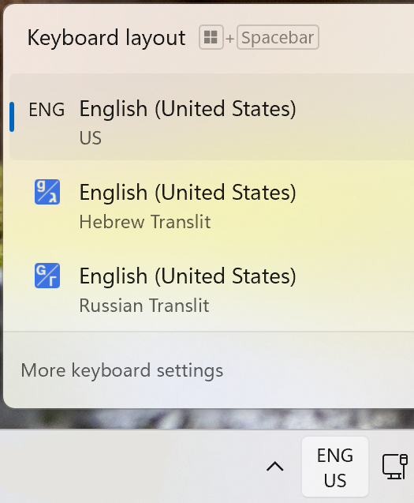
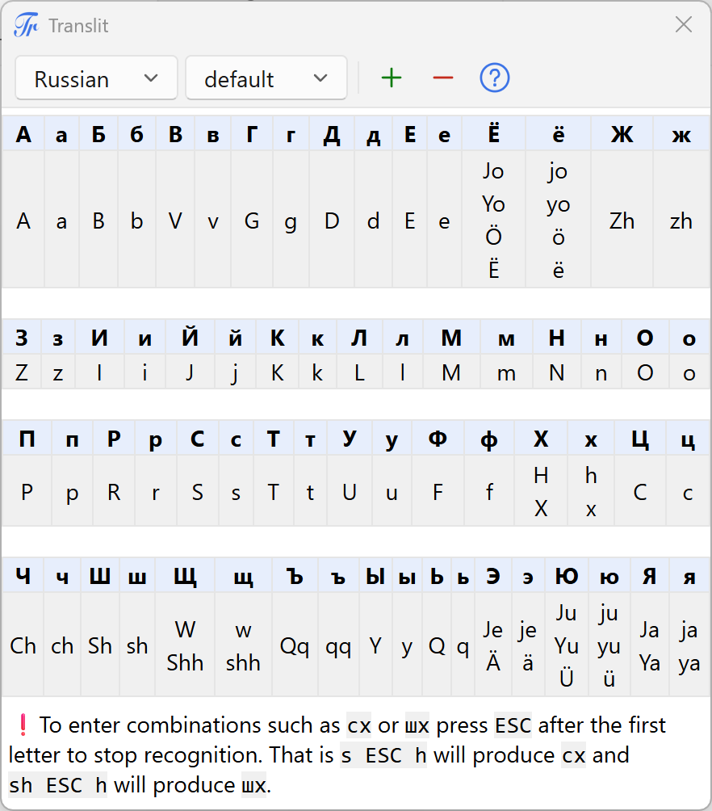

# Translit for Windows

![Windows][win-badge]
![Platforms][platforms-badge]
[![License][license-badge]][license]

This Windows _text service_[^1] allows a user familiar only with a Latin alphabet keyboard to 
type in other languages by using common Latin transliterations of the target language letters. 
Currently supported target languages are Russian, Hebrew, Ukrainian and Belarusian. 
To give an example, typing `privet` in Russian mode will produce `привет` and typing `hi` in Hebrew mode will produce `הי`.

[^1]: sometimes called an IME, but technically an IME is a different, older technology.

> [!NOTE]
> This software is for Windows only. A macOS version is available [here][mactranslit].

- [Features](#features)
- [Installation](#installation)
- [Configuration](#configuration)
- [Uninstall](#uninstall)
- [Mappings](#mappings)
- [Building](#building)

## Features

- Type normally in any window without copy/pasting from a separate app/browser.
- Integrates natively with Windows language/keyboard switching support using official, documented Microsoft APIs. 
  No hacky apps that need to run in the background and hook/hack into the OS workings.
- Works everywhere: desktop and store apps, on the login screen, on x64, x86 and arm64 architectures.
- Supports Windows 10 and 11.
- Supports multiple languages: currently Russian, Hebrew, Ukrainian and Belarusian, with an easy way 
  to add more, if desired.
- An option not to use punctuation like `'` or `#` for transliteration. 
  When typing normally on Windows (as opposed to some dedicated transliteration app), switching between 
  input modes is more complicated - you cannot just press `ESC` like [translit.ru][translit_ru] does. 
  This makes typing text with lots of punctuation annoying. Avoiding punctuation, such as using `q` for `ь` 
  and `qq` for `ъ`, can make typing much smoother. 
- Support for multiple transliteration schemes. Since some people would rather use familiar transliteration schemes
  from elsewhere, this application allows you to choose the scheme.
  Currently, in addition to the default, [translit.ru/translit.net][translit_ru] schemes are supported for Russian, Ukrainian and Belarusian. More can be added, if desired.

  There are existing Windows transliteration apps available on the Internet, but none of them supports all the features above.

## Installation
  
* Navigate to the [Releases][releases] page and download the `Translit-x64.msi` or the `Translit-arm64.msi` 
  installer, depending on your computer hardware. 
* Run it and install the app.
* During the installation you will be prompted to select the _default_ languages to enable. These will be enabled
  for all users on first use. Don't worry if you select the wrong ones - all users will also be 
  able to add or remove languages for themselves later in the application settings.
* When the installation finishes, look at the system tray. There will be a language icon there (if you didn't already
  have one). When you click it, it should open a menu like this (assuming you selected Russian and Hebrew during the installation):
  
   
* That's pretty much it. You can now switch between normal typing and Translit in any app using this menu or via the
  `⊞ + Spacebar` key combination. 

## Configuration

When one of the Translit languages is active, the system tray will have one additional icon 
(circled in red below):

 

Clicking it will launch the Translit settings app. You can also launch the settings from 
`Start Menu -> Translit`.

The settings app screen looks like this:

 

It shows you the letter mappings for the language and transliteration scheme selected at the top. 
Changing the scheme makes it the default for all apps for that language.

The + and - buttons allow you to add and remove languages. The ?⃝ button opens a traditional About 
dialog.

The app stays on top of other windows to allow you to see the mappings when typing in another window.

## Uninstall

Translit can be fully uninstalled via the standard "Add/Remove Programs" (a.k.a. "Apps->Installed Apps")
system panel.

## Mappings

Currently supported character mappings can be found in the following documents:

* [Belarusian](doc/mapping-be.md)
* [Hebrew](doc/mapping-he.md)
* [Russian](doc/mapping-ru.md)
* [Ukrainian](doc/mapping-uk.md)

## Building

Visual Studio 2022 or above and Python 3.11 or above are the only requirements to build Translit.
If you want to build the installers, you will also need [WiX Toolset][wix-toolset] CLI version 6.

* Download/clone the repo.
* Run the `fetch.py` script from the top-level directory. 
  This will fetch external dependencies.
* Open `Translit.sln` in Visual Studio and build the `Translit`, `Settings` or `Installer` targets.

<!-- Links -->
[translit_ru]: https://translit.ru
[releases]: https://github.com/gershnik/TranslitForWindows/releases
[mactranslit]: https://github.com/gershnik/Translit
[wix-toolset]: https://github.com/wixtoolset/wix

[win-badge]: https://img.shields.io/badge/Windows-10,%2011-blue?style=flat&labelColor=black
[platforms-badge]: https://img.shields.io/badge/Platforms-x64,%20arm64-blue?style=flat&labelColor=black
[license-badge]: https://img.shields.io/badge/license-GPLv3-red.svg
[license]: https://opensource.org/license/gpl-3-0/

<!-- End Links -->
